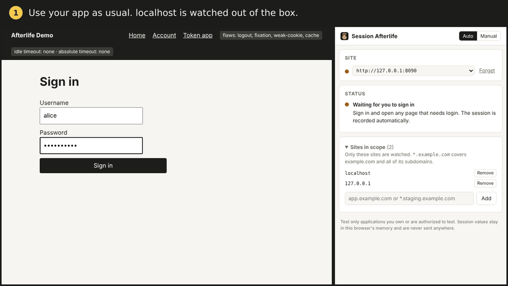
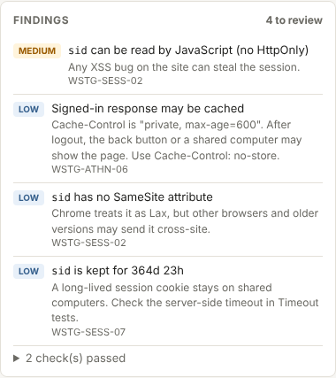
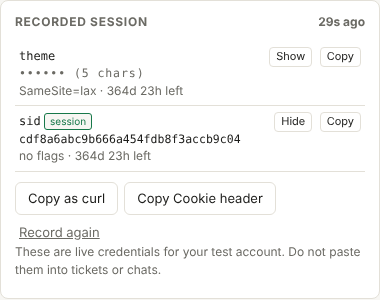
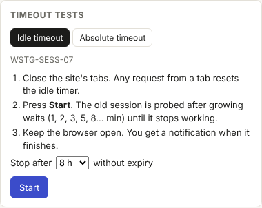
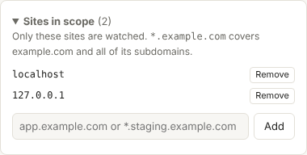
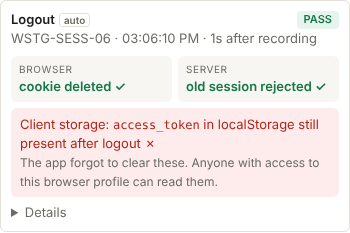
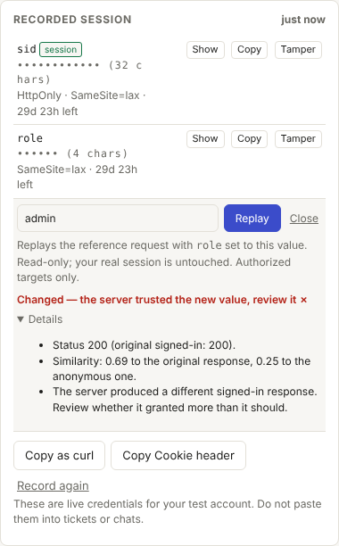

<div align="center">


# Session Afterlife

**Does your logout really end the session?**

A Chrome extension that catches sessions that survive logout, password changes and timeouts,<br>
and audits session cookies and tokens while you use your app. No proxy, no setup.

[](https://github.com/enesbaldemir/session-afterlife/actions/workflows/test.yml)
[](LICENSE)




</div>

## Why

When you click **Log out**, most apps delete the cookie in your browser. That proves nothing. If the server never invalidated the session, anyone who copied the cookie earlier (from a shared computer, a log file, an XSS bug or a stolen laptop) can keep using the account. The same goes for "change your password to kick everyone out" and for sessions that never time out.

Checking this by hand means copying cookies, logging out, replaying requests in a proxy and comparing responses, every time. Session Afterlife does it in the background while you click through your app, and tells you both sides:

> **Browser:** cookie deleted ✓ · **Server:** old session still valid ✗

## Try it in 60 seconds

```sh
git clone https://github.com/enesbaldemir/session-afterlife
cd session-afterlife
node demo/server.js --flaws logout,fixation,weak-cookie,cache
```

1. Open `chrome://extensions`, turn on **Developer mode**, click **Load unpacked** and choose the `extension` folder.
2. Open <http://127.0.0.1:8090>, click the extension icon, and sign in as `alice` / `wonderland`.
3. Watch the findings appear, then click **Log out**.

The demo app needs only Node.js (no `npm install`). Run `node demo/server.js` without flaws to see everything pass.

### Firefox

Session Afterlife runs on Firefox too (140+). Build the Firefox package and load it temporarily:

```sh
npm run build          # writes dist/chrome/ and dist/firefox/
```

Open `about:debugging` → **This Firefox** → **Load Temporary Add-on**, and choose `dist/firefox/manifest.json`. The panel opens as a sidebar (toggle it with the toolbar icon). On Firefox the cookie replay uses blocking `webRequest` instead of `declarativeNetRequest`; everything else is the same.

## Features

- 🔁 **Replays the old session automatically** after logout and after a password change, and reports whether the server still accepts it.
- 🍪 **Audits the session cookie**: `HttpOnly`, `Secure`, `SameSite`, `Domain`, lifetime. It measures which cookie actually carries the session, so a theme or language cookie does not cause noise.
- 🧷 **Detects session fixation** by noticing that the session cookie kept its value through the login.
- 🔗 **Finds session tokens in URLs** and **signed-in pages that can be cached**.
- 🪪 **Decodes JWTs** and flags `alg: none`, missing or very long expiry, and readable sensitive claims.
- ⏱️ **Measures idle and absolute timeouts** on the server, not just what the cookie claims.
- 🔍 **Shows the recorded cookies and tokens** (masked until you click **Show**) and copies a ready-to-run **curl** command with the old session for your report.
- 🧪 **Tamper check**: change one cookie value and replay the reference request to see whether the server trusts a client-supplied value (for example `role=user` → `role=admin`). Read-only, and your real session is left untouched.
- 🧹 **Post-logout storage check**: after logout it looks for session tokens left behind in `localStorage`, `sessionStorage` and IndexedDB — a common gap where the cookie is cleared but an access token lingers in the browser.
- 📄 **Exports a Markdown report** with WSTG references and no secrets in it.
- 🧭 **Stays in scope**: only the sites you list are watched. `localhost` and `127.0.0.1` are in the list from the start.

## What it checks

| Check | When | Guide reference |
| --- | --- | --- |
| Logout ends the session | After you log out | [WSTG-SESS-06](https://owasp.org/www-project-web-security-testing-guide/latest/4-Web_Application_Security_Testing/06-Session_Management_Testing/06-Testing_for_Logout_Functionality) |
| Session tokens left in browser storage after logout | After you log out | WSTG-CLNT-12 |
| Password change ends other sessions | After a second login and a password change | WSTG-ATHN-08 |
| A new login elsewhere (informational) | After a second login | WSTG-SESS-11 |
| Cookie attributes | When you sign in | [WSTG-SESS-02](https://owasp.org/www-project-web-security-testing-guide/latest/4-Web_Application_Security_Testing/06-Session_Management_Testing/02-Testing_for_Cookies_Attributes) |
| Session fixation | When you sign in | [WSTG-SESS-03](https://owasp.org/www-project-web-security-testing-guide/latest/4-Web_Application_Security_Testing/06-Session_Management_Testing/03-Testing_for_Session_Fixation) |
| Session token in a URL | While you browse | WSTG-SESS-04 |
| Caching of signed-in pages | When you sign in | WSTG-ATHN-06 |
| JWT weaknesses | When you sign in | WSTG-SESS-10 |
| Idle and absolute timeout | When you start it | [WSTG-SESS-07](https://owasp.org/www-project-web-security-testing-guide/latest/4-Web_Application_Security_Testing/06-Session_Management_Testing/07-Testing_Session_Timeout) |

Cookie-based sessions (including `HttpOnly` cookies) and token-based sessions sent in the `Authorization` header are both supported.

## How it compares

| | Manual (proxy + copy/paste) | [ghostsession](https://github.com/277levi/ghostsession) | [Burp: Session Timeout Test](https://portswigger.net/bappstore/c4bfd29882974712a1d69c6d8f05874e) | **Session Afterlife** |
| --- | :---: | :---: | :---: | :---: |
| Runs in the browser, no proxy or HAR | – | – | – | ✓ |
| Checks automatically as you use the app | – | – | – | ✓ |
| Logout | ✓ | ✓ | – | ✓ |
| Password change and second login | ✓ | – | – | ✓ |
| Idle and absolute timeout | ✓ | – | idle | ✓ |
| Cookie, fixation, URL token, cache and JWT checks | ✓ | – | – | ✓ |
| Report with guide references | – | – | – | ✓ |

## Screenshots

| Findings | Recorded session |
| --- | --- |
|  |  |
| **Timeout tests** | **Sites in scope** |
|  |  |

## Usage

### Sites in scope

The extension only looks at sites in its scope list. To add one, open it and click the extension icon: the panel offers **Watch this site** (or the whole parent domain, such as `*.staging.example.com`). You can also type a site under **Sites in scope**. Chrome asks for access to that site once.

The toolbar icon is in colour on sites in scope and grey elsewhere, and shows a red number when a check failed on that site.

### Automatic mode (default)

- **Sign in.** The extension notices the signed-in pages, picks one that clearly differs with and without the session, records the session, and runs the passive checks.
- **Log out.** The old session is replayed a moment later. The result appears in the panel and as a notification.
- **Password change:** click **Test password change and a second login**. The site's cookies are cleared in this browser (the recorded session is kept), you sign in again, and the extension reports whether the first session survived the new login. Then change the password; the first session is checked again.
- If your app's logout is not recognised, click **I logged out, check now**.

The extension never logs in, logs out or changes passwords by itself, and never asks for your credentials. Logout is recognised by requests such as `/logout`, `/sign-out` or `DELETE /api/session`, or by the session cookie being removed. A password change is recognised by a successful `POST`, `PUT` or `PATCH` to a URL such as `/password`; a failed attempt does not count.

After a logout the result also shows whether session tokens were left behind in the browser's own storage, so a clean server-side logout that still leaks an access token into `localStorage` does not slip through:



### Timeout tests

The idle test waits 1, 2, 3, 5, 8, 12, 18, 25, 35, 50… minutes between probes. Each successful probe resets the server's idle timer, so the first failure brackets the timeout, for example "Idle timeout is between 25 min and 35 min". Close the site's tabs while it runs; the panel tells you if a tab interfered. The absolute test probes every few minutes, which keeps the session active, and records when it ends anyway. Keep the browser open; you get a notification when the result is ready.

### Tamper check

**Tamper** next to a cookie replays the reference request with that cookie set to a value you type, to check whether the server trusts what the client sends:

- **Rejected** — the server no longer treats you as signed in, so it validates the value (what you want for a session ID).
- **No change** — the server ignored the new value for this request.
- **Changed** — the server produced a different signed-in response, so it trusted the value. Review whether it granted more than it should, for example an admin section appearing after `role=admin`.

Only `GET`/`HEAD` is replayed, and the change applies only to the extension's own request; your browser's real session is not modified.



### Manual mode

Switch to **Manual** at the top of the panel to pick the reference request yourself, add a *marker* (text that only a signed-in user sees, for pages that change a lot between loads), record the session and run each test.

## How it works

- **Capture:** `chrome.webRequest` (with `extraHeaders`) sees the requests your tabs send to sites in scope, including the `Cookie` and `Authorization` headers.
- **Recording:** `chrome.cookies` reads every cookie that applies to the reference URL, `HttpOnly` cookies included.
- **Replay:** the background worker sends the reference request with `credentials: "omit"`, so your browser's current cookies are left out. The old `Cookie` header is set for that one request only — on Chrome via a temporary `declarativeNetRequest` session rule scoped to the extension's own requests, on Firefox via a blocking `webRequest` listener matched by a nonce header. Response cookies are ignored, so your browser state does not change.
- **Verdict:** the replayed response is compared with a signed-in and an anonymous baseline (status, final URL after redirects, page text similarity), or checked for the marker: **STILL VALID**, **INVALIDATED** or **INCONCLUSIVE**, always with the reason.
- **Session cookie detection:** the reference request is replayed without each cookie in turn; the ones whose absence logs you out are the session cookies.
- **Fixation:** `chrome.cookies.onChanged` records when each cookie got its value; a session value older than the login form submission means it was not renewed.

## FAQ

<details>
<summary><b>Does it send my cookies anywhere?</b></summary>

No. Session values live in `chrome.storage.session`, which is in memory and cleared when the browser closes. The extension only talks to the sites in your scope list. There is no analytics, no server and no remote code. See [PRIVACY.md](PRIVACY.md).
</details>

<details>
<summary><b>Can it break something in my app?</b></summary>

It only replays `GET` and `HEAD` requests, and never replays URLs with words such as `delete`, `logout` or `unsubscribe`. It never submits forms. The tamper check also only replays the reference request and does not touch your real session. The one thing that changes your browser is **Test password change and a second login**, which clears that site's cookies so that you can sign in again.
</details>

<details>
<summary><b>Why does it not watch every site?</b></summary>

Testing sites you are not authorized to test is not okay, and an extension that holds every site's session would be a tempting target. The scope list keeps it to your own apps; adding a site takes one click.
</details>

<details>
<summary><b>Does it work with single-page apps and JWTs?</b></summary>

Yes, as long as the token is sent in a request header (`Authorization: Bearer …` or a custom header). The token is replayed from the captured request. Tokens that only live in JavaScript memory and are never sent cannot be seen.
</details>

<details>
<summary><b>What does INCONCLUSIVE mean?</b></summary>

The replayed response did not clearly match either the signed-in or the anonymous baseline, for example because the page changes a lot between loads. Switch to manual mode, pick an API endpoint such as `/api/me`, or add a marker.
</details>

<details>
<summary><b>Can I use it in a bug bounty program?</b></summary>

Only within the program's scope and rules. Add the in-scope domains to the scope list and nothing else.
</details>

## Demo app

`demo/server.js` is a small dependency-free app with switchable flaws, used in the demo and the tests. Flaws can be combined with commas:

| Flag | Flaw |
| --- | --- |
| `logout` | Logout deletes the cookie but keeps the session on the server |
| `logout-rotate` | Logout replaces the cookie but keeps the old session |
| `password` | A password change does not end other sessions |
| `jwt` | API logout does not revoke the bearer token (try `/spa`) |
| `fixation` | The session ID issued before login is kept after it |
| `weak-cookie` | No `HttpOnly`, no `SameSite`, kept for a year |
| `cache` | Signed-in pages are cacheable |
| `token-in-url` | The session ID is put in the URL after login |
| `trust-role` | A client-side `role` cookie decides what the account page shows |
| `storage-logout` | An access token is kept in `localStorage` and not cleared at logout |

`--idle 300` and `--absolute 3600` set server timeouts in seconds.

## Roadmap

- [ ] Chrome Web Store release
- [x] Firefox support (sidebar; blocking webRequest for cookie replay)
- [ ] Refresh token rotation and reuse detection
- [ ] OpenID Connect logout (RP-initiated and back-channel)
- [ ] Partitioned (CHIPS) cookies
- [ ] JSON and SARIF export

Ideas and pull requests are welcome. See [CONTRIBUTING.md](CONTRIBUTING.md).

## Limitations

- Verdicts are heuristic. Use manual mode and a marker for pages with a lot of changing content.
- A server that issues a new session ID on every request and rejects the previous one will look like it invalidated the session.
- Timeout tests run in real time and one at a time.

## Development

```sh
npm test                      # unit tests (Node 20+)
npm run test:e2e              # end-to-end tests in Chromium with the extension loaded (needs Playwright)
npm run build                 # dist/chrome/ and dist/firefox/ (+ zips) for both stores
npm run lint:firefox          # web-ext lint of the Firefox build
npm run pack                  # Chrome-only zip
node scripts/screenshots.js   # README screenshots
node scripts/demo-gif.js      # docs/demo.gif (needs ffmpeg)
```

## Security

Found a vulnerability in the extension itself? Please report it privately; see [SECURITY.md](SECURITY.md).

> [!IMPORTANT]
> Use Session Afterlife only on applications you own or are authorized to test.

## License

[MIT](LICENSE)
